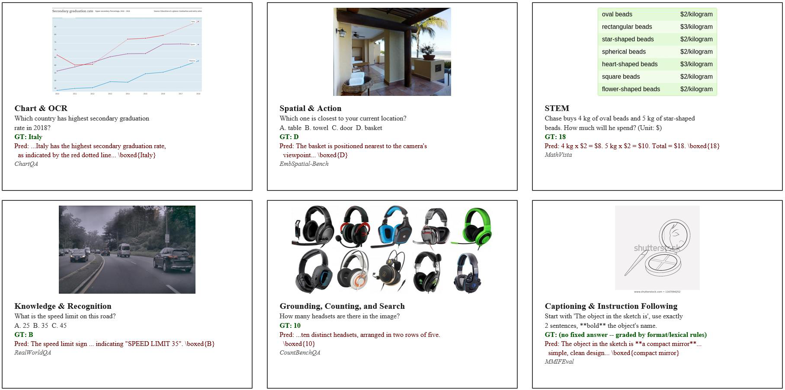
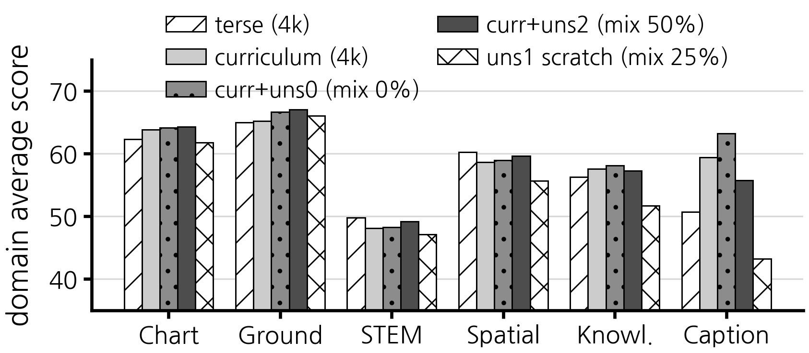
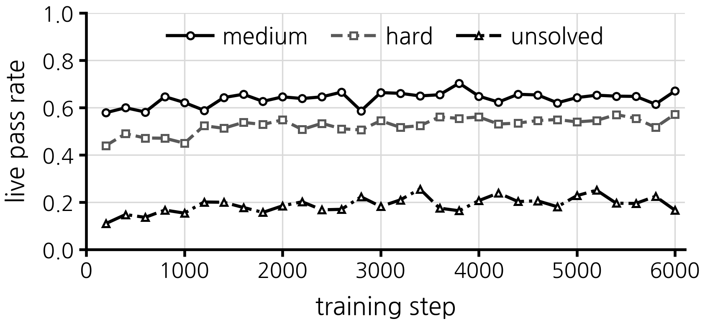

# Visual Reasoning RL under Limited Resources: Difficulty-Aware Online Curriculum and Format-Level Reward Hacking
**제한된 자원 환경에서의 시각 추론 강화학습: 난이도 인지 온라인 커리큘럼과 형식 수준 보상 해킹 분석**

Hyeon-Sung Choi, Jong-Eun Ha*  
Seoul National University of Science and Technology

- Submitted to *Journal of Institute of Control, Robotics and Systems* (2026)
- Revised manuscript (2026/10) · Under review

[](LICENSE)

> 🚀 This project is built on **[Vero](https://github.com/zlab-princeton/vero)** (Princeton zlab, 2026): an open RL recipe for general visual reasoning that bundles a [veRL](https://github.com/volcengine/verl) training fork (`vero-rl`) and an [lmms-eval](https://github.com/EvolvingLMMs-Lab/lmms-eval) fork (`vero-eval`).  
> The original Vero README is kept at [`docs/README_Vero.md`](docs/README_Vero.md).

---

## Abstract

Visual reasoning reinforcement learning (RL) typically requires large-scale data and datacenter-class GPU clusters, limiting its reproducibility in resource-constrained laboratories. This study investigates whether an open visual reasoning RL recipe remains effective on a single workstation equipped with two RTX 4090 GPUs. Because this setting permits only a small batch and four rollouts per prompt, the training runs observe only 2.7–4.0% of the 600K training pool used by the reference recipe. We first employ a **terse reasoning prompt** to preserve valid answer and reward signals under a limited generation-token budget. We then introduce a **difficulty-aware online curriculum** that dynamically allocates samples according to *p̂ₜ(1 − p̂ₜ)*, where *p̂ₜ* is the recent pass rate of each difficulty tier. An **unsolved-frontier** strategy is further evaluated by forcing a minimum number of previously unsolved samples into each batch. Across 27 benchmarks, all trained variants outperform the untrained base model by 9.0–13.4 points under the same evaluation protocol. The proposed curriculum improves the average score over balanced sampling by 0.9 points, although the difference is not statistically significant. Frontier exploration raises the live pass rate of the unsolved tier from 0 to 0.16–0.25 but provides no measurable improvement in overall generalization. When introduced from the beginning of training, it instead causes the evaluated answer field to collapse in 59.0% of captioning responses despite a higher training reward, revealing **format-level reward hacking**. These results demonstrate the feasibility of visual reasoning RL with limited resources while highlighting the importance of protocol-controlled evaluation, adequate rollout diversity, and alignment between training rewards and downstream metrics.

## Keywords

visual reasoning · reinforcement learning · vision-language model · curriculum learning · low-resource training · reward hacking

---

## Method

<p align="center">
  
  <br>
  <em>Fig. 1. Examples of the six task domains and the scoring rules used in training and evaluation (rule-based checkers for discrete answers, an LLM judge for open-ended responses).</em>
</p>

**Setting.** Qwen3-VL-8B-Instruct is fine-tuned with LoRA (rank 32, alpha 64, language module only) using GSPO on 2 × RTX 4090 (24 GB each): batch 4, *n* = 4 rollouts per prompt, max prompt 512 / max response 1,536 tokens, vLLM rollout workers with tensor parallel 2, and a Qwen3-32B-AWQ judge that is put to sleep whenever it is not scoring. One step observes 16 rollouts, versus 2,048 in the reference Vero recipe.

1. **Terse reasoning prompt** – a short `<think>…</think><answer>…\boxed{}</answer>` format so that the final answer (and therefore the reward) survives the 512-token generation budget ([`vero-rl/examples/prompts/system_prompt_concise.txt`](vero-rl/examples/prompts/system_prompt_concise.txt)).
2. **Difficulty labelling (k = 4)** – every prompt in the 600K pool is labelled with the base model's pass rate over 4 samples and binned into `easy` (4/4), `medium` (2–3/4), `hard` (1/4) and `unsolved` (0/4) ([`curriculum/difficulty_label.py`](curriculum/difficulty_label.py)). 49.5% of the pool is unsolved by the base model.
3. **p(1 − p) online curriculum** – every *K* = 200 steps the live pass rate *p̂ₜ* of each tier is re-estimated from the rollouts; the sampling weight is *wₜ ∝ p̂ₜ(1 − p̂ₜ)*, so tiers where the policy is roughly 50/50 get the most budget and tiers that are fully solved or fully unsolved get none ([`vero-rl/verl/experimental/dataset/curriculum_tier_sampler.py`](vero-rl/verl/experimental/dataset/curriculum_tier_sampler.py)).
4. **Unsolved-frontier exploration** – `min_unsolved = m` forces at least *m* unsolved prompts into every batch of 4 (Algorithm 1 in the paper); evaluated both as a continuation of the curriculum model and from scratch.

| Variant | Start | Steps | Sampling |
|---|---|---:|---|
| `terse 4k` | base | 4,000 | balanced (baseline) |
| `curr. 4k` | base | 4,000 | p(1 − p) curriculum |
| `curr + uns0` | curr. 4k | +2,000 | curriculum, `min_unsolved=0` (control) |
| `curr + uns2` | curr. 4k | +2,000 | curriculum, `min_unsolved=2` (50% forced) |
| `uns1 6k` | base | 6,000 | curriculum, `min_unsolved=1` (25% forced, from scratch) |

---

## Results

All numbers below are measured with one fixed protocol (terse system prompt, max 262,144 pixels, max 512 new tokens, greedy decoding, Qwen3-32B-AWQ judge) using [`eval_harness/run_full_eval.sh`](eval_harness/run_full_eval.sh). The two *Reference* columns are quoted from the Vero paper and were measured under a different protocol (16,384 tokens, 4096² pixels, temperature 1.0), so they are not directly comparable; the re-measured `base` column is the reference for all comparisons.

**Table 1. Benchmark comparison (27 benchmarks, accuracy %)**

| Domain | Benchmark | base (cited) | Vero (cited) | base (ours) | terse 4k | curr. 4k | curr + uns0 | curr + uns2 | uns1 6k |
|---|---|---:|---:|---:|---:|---:|---:|---:|---:|
| Chart & OCR | ChartQA | 89.6 | 91.6 | 75.6 | 88.9 | 85.9 | 88.8 | 88.8 | 88.6 |
| Chart & OCR | ChartQA-Pro | 44.3 | 60.2 | 42.8 | 55.6 | 58.2 | 57.6 | 56.9 | 50.9 |
| Chart & OCR | InfoVQA | 83.1 | 87.8 | 63.4 | 78.6 | 79.7 | 81.7 | 80.5 | 80.6 |
| Chart & OCR | CharXiv | 46.4 | 53.7 | 40.5 | 46.2 | 51.6 | 49.3 | 50.1 | 44.8 |
| Chart & OCR | ChartMuseum | 40.0 | 49.6 | 32.3 | 37.9 | 40.3 | 39.7 | 40.5 | 38.9 |
| Chart & OCR | EvoChart | 64.0 | 75.7 | 55.8 | 66.6 | 67.2 | 67.6 | 68.9 | 66.9 |
| Ground & Count | CountBenchQA | 88.8 | 90.4 | 77.0 | 80.9 | 87.8 | 88.0 | 89.6 | 85.7 |
| Ground & Count | CountQA | 28.5 | 33.9 | 24.8 | 22.5 | 29.6 | 29.5 | 30.4 | 30.0 |
| Ground & Count | MME-RealWorld | 47.1 | 57.8 | 34.2 | 49.5 | 53.4 | 55.6 | 54.7 | 53.0 |
| Ground & Count | V*Bench | 82.2 | 89.5 | 64.4 | 86.4 | 84.8 | 84.3 | 82.2 | 83.2 |
| Ground & Count | VisualProbe | 47.7 | 53.9 | 55.3 | 61.7 | 57.5 | 58.9 | 60.3 | 60.3 |
| Ground & Count | ScreenSpot † | 86.6 | 93.6 | 61.2 | 89.1 | 78.4 | 83.8 | 85.2 | 84.0 |
| STEM | MMMU-Pro Std | 55.9 | 59.8 | 38.1 | 48.2 | 45.7 | 46.8 | 48.3 | 46.1 |
| STEM | MMMU-Pro Vis | 42.1 | 57.2 | 42.2 | 45.8 | 45.1 | 44.6 | 45.5 | 43.5 |
| STEM | MathVision | 53.9 | 59.0 | 23.0 | 31.5 | 28.6 | 27.5 | 29.5 | 28.3 |
| STEM | MathVista | 77.2 | 78.7 | 59.3 | 73.7 | 73.0 | 74.3 | 73.6 | 70.7 |
| Spatial | Blink | 69.1 | 68.7 | 51.9 | 57.1 | 50.4 | 52.6 | 54.9 | 47.4 |
| Spatial | ERQA | 45.8 | 43.2 | 33.5 | 42.3 | 43.8 | 43.8 | 41.5 | 38.2 |
| Spatial | GameQA | 34.0 | 52.3 | 24.1 | 36.1 | 31.5 | 31.2 | 34.0 | 30.7 |
| Spatial | EmbSpatial | 78.5 | 79.2 | 47.3 | 78.9 | 80.3 | 80.0 | 80.6 | 75.0 |
| Spatial | CV-Bench | 85.5 | 87.9 | 65.6 | 86.9 | 87.1 | 87.3 | 87.4 | 86.9 |
| Knowledge | RealWorldQA | 71.5 | 73.3 | 43.7 | 69.4 | 69.8 | 71.1 | 71.9 | 58.7 |
| Knowledge | SimpleVQA | 44.2 | 45.2 | 34.5 | 42.9 | 43.8 | 44.5 | 43.3 | 44.1 |
| Knowledge | MM-Vet | 67.6 | 70.2 | 44.7 | 56.5 | 59.1 | 58.7 | 56.6 | 52.3 |
| Caption & IF | MM-MTBench | 74.4 | 80.3 | 41.6 | 36.9 | 41.8 | 40.7 | 33.9 | 30.2 |
| Caption & IF | MIABench | 91.1 | 93.5 | 53.3 | 64.1 | 77.1 | 81.0 | 72.6 | 47.5 |
| Caption & IF | MMIFEval | 69.2 | 77.7 | 45.3 | 51.2 | 59.4 | 68.0 | 60.8 | 52.0 |
| **Mean** | | 63.3 | 69.0 | **47.2** | **58.7** | **59.7** | **60.6** | **60.1** | **56.3** |

† ScreenSpot is scored with the same 0–1000 normalized coordinate format for all six models (re-scored from saved outputs with [`curriculum/rescore_screenspot_all.py`](curriculum/rescore_screenspot_all.py)).

<p align="center">
  
  <br>
  <em>Fig. 3. Per-domain average of the trained models. The curriculum recovers most on the captioning domain, where the terse baseline was weakest.</em>
</p>

**Table 2. Live pass rate (p) and sampling weight (w) of the medium / hard tiers during curriculum training**

| step | medium_p | hard_p | medium_w | hard_w |
|---:|---:|---:|---:|---:|
| 200 | 0.576 | 0.439 | 0.460 | 0.464 |
| 1000 | 0.626 | 0.533 | 0.448 | 0.476 |
| 2000 | 0.667 | 0.523 | 0.434 | 0.488 |
| 3000 | 0.607 | 0.514 | 0.452 | 0.473 |
| 4000 | 0.694 | 0.567 | 0.427 | 0.493 |
| Δ | +0.118 | +0.128 | −0.033 | +0.029 |

<p align="center">
  
  <br>
  <em>Fig. 2. Live pass rate per tier during the from-scratch frontier run (uns1). Forcing unsolved prompts lifts their live pass rate from ≈0 to 0.16–0.25, but this does not transfer to the benchmarks.</em>
</p>

**Table 3. Output-format analysis on 400 MIABench items (format-level reward hacking)**

| Model | Forced unsolved mix | `<answer>` median (chars) | Preceding text median (chars) | Format collapse rate |
|---|---:|---:|---:|---:|
| terse 4k | – | 82 | 195 | 23.8% |
| curr. 4k | – | 138 | 274 | 10.8% |
| curr + uns0 | 0% | 160 | 296 | 13.2% |
| curr + uns2 | 50% | 140 | 251 | 18.5% |
| uns1 (scratch) | 25% | 30 | 236 | **59.0%** |

**Summary.** On two consumer GPUs and ≈3% of the reference data, every trained variant beats the re-measured base by 9.0–13.4 points. The p(1 − p) curriculum adds +0.9 over balanced sampling (not significant on 27 paired benchmarks) with consistent gains on captioning. Forcing unsolved prompts from the start raises the training reward yet collapses the graded `<answer>` field in 59% of captioning responses: a mismatch between the training reward and the downstream metric that must be monitored alongside reward curves.

---

## Repository layout

| Path | What it is |
|---|---|
| `vero-rl/` | Vero's veRL fork. Our additions: `verl/experimental/dataset/curriculum_tier_sampler.py` (p(1 − p) tier sampler + `min_unsolved`), the 2 × 4090 configs `examples/model_runs/config/gspo_qwen3vl_*lite.yaml`, run scripts `examples/model_runs/run_gspo_qwen3vl_*lite.sh`, the terse prompt `examples/prompts/system_prompt_concise.txt`, and the LoRA / vLLM 0.17 / Qwen3-VL compatibility fixes listed in [`docs/RESULTS_2x4090.md`](docs/RESULTS_2x4090.md). |
| `vero-eval/` | Vero's lmms-eval fork, plus a system-prompt hook for the vLLM chat model and a 0–1000 coordinate ScreenSpot scorer. |
| `curriculum/` | Difficulty labelling (`difficulty_label.py`, `difficulty_crosstab.py`), experiment launch / chain scripts (`run_ablation_uns0.sh`, `chain_scratch_uns1.sh`, …), result collection and figure scripts, final result tables (`final_table_*.json`). |
| `eval_harness/` | `run_full_eval.sh`: the fixed 27-benchmark protocol used for every number in this README. |
| `investigation_2x4090/` | Reproduction log of the 2 × 4090 port (`INVESTIGATION_LOG.md`), LoRA merge script, re-scoring utilities, vLLM diagnostics. |
| `docs/` | Upstream Vero docs (`README_Vero.md`, `TRAINING.md`, `EVALUATION.md`, `DATA.md`, `MODELS.md`), our 2 × 4090 reproduction report and curriculum design notes (Korean). |
| `figs/` | Figures used in this README. |

Logs, checkpoints, rollout dumps, evaluation outputs and the 600K image data are **not** included; see `.gitignore`.

---

## Setup and usage

See [`setup.md`](setup.md) for environment creation, data preparation, difficulty labelling, curriculum training on 2 × RTX 4090, LoRA merging and the full evaluation protocol.

```bash
# 1. environment (conda env "verovlm": torch 2.10 + cu130, vLLM 0.17, flash-attn)
bash scripts/setup_env.sh

# 2. data: Vero-600k in veRL jsonl format + images  (set VERO_DATA to where it lives)
export VERO_DATA=/path/to/data      # expects $VERO_DATA/vero-600k/{vero_600k_train.verl.jsonl, images/...}

# 3. difficulty labels (base model, k=4, rule-scored tasks)  -> curriculum/difficulty_labels_full.jsonl
bash curriculum/run_full_labeling.sh

# 4. curriculum training on 2 x RTX 4090 (GSPO + LoRA + AWQ judge)
cd vero-rl && bash examples/model_runs/run_gspo_qwen3vl_judge_lite.sh      # p(1-p) curriculum, min_unsolved from the yaml

# 5. merge LoRA and evaluate with the fixed protocol
python investigation_2x4090/merge_lora.py <checkpoint_dir> <merged_dir>
bash eval_harness/run_full_eval.sh <merged_dir> <exp_name>
```

---

## Citation

```bibtex
@article{choi2026lowresource_visual_rl,
  title   = {Visual Reasoning Reinforcement Learning under Limited Resources: Analysis of a Difficulty-Aware Online Curriculum and Format-Level Reward Hacking},
  author  = {Choi, Hyeon-Sung and Ha, Jong-Eun},
  journal = {Journal of Institute of Control, Robotics and Systems},
  year    = {2026},
  note    = {under review}
}
```

Please also cite Vero, veRL and lmms-eval, on which this work is built:

```bibtex
@article{vero2026,
  title   = {Vero: An Open RL Recipe for General Visual Reasoning},
  author  = {zlab-princeton},
  journal = {arXiv preprint arXiv:2604.04917},
  year    = {2026}
}
```

## License

Apache License 2.0, inherited from Vero / veRL (see [`LICENSE`](LICENSE)). `vero-eval` carries its own lmms-eval license file.

## Acknowledgements

This work was supported by the Seoul National University of Science and Technology internal research fund. Built on [Vero](https://github.com/zlab-princeton/vero), [veRL](https://github.com/volcengine/verl), [lmms-eval](https://github.com/EvolvingLMMs-Lab/lmms-eval), [vLLM](https://github.com/vllm-project/vllm) and [Qwen3-VL](https://github.com/QwenLM/Qwen3-VL).
